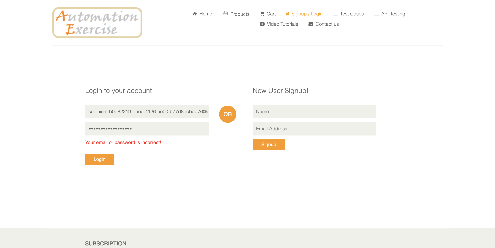

# Evidências da execução

Execução real em 05/10/2026, concluída às 19:02:56 (America/Sao_Paulo).

Comando: `mvn test` — Chrome com janela gráfica, Java 21.0.11, Selenium 4.26.0 e JUnit 5.11.3.

**BUILD SUCCESS: 15 testes, 0 falhas, 0 erros e 0 ignorados.** Tempo total do Maven: 3 min 23 s.

| Classe | Testes | Falhas | Erros | Ignorados | Duração (s) |
| --- | --- | --- | --- | --- | --- |
| br.com.qualidade.LoginTest | 7 | 0 | 0 | 0 | 48.633 |
| br.com.qualidade.RegistroTest | 8 | 0 | 0 | 0 | 144.155 |

Os IDs correspondem à matriz do README principal. Os arquivos `Lxx-final.png` e `Rxx-final.png` registram o estado ao final de cada entrada. `R01` a `R04` também possuem capturas `-criado` e `-excluido`, confirmando as duas etapas. Todas as quatro contas criadas foram excluídas pelo fluxo do teste.

Os XMLs são derivados dos relatórios Surefire: propriedades locais de ambiente e logs auxiliares foram omitidos; resultados e tempos das entradas foram preservados. Os relatórios TXT foram copiados sem alteração. Os relatórios originais ficam em `target/surefire-reports/` na máquina de execução.

### Login incorreto

### Conta criada

### Conta excluída

